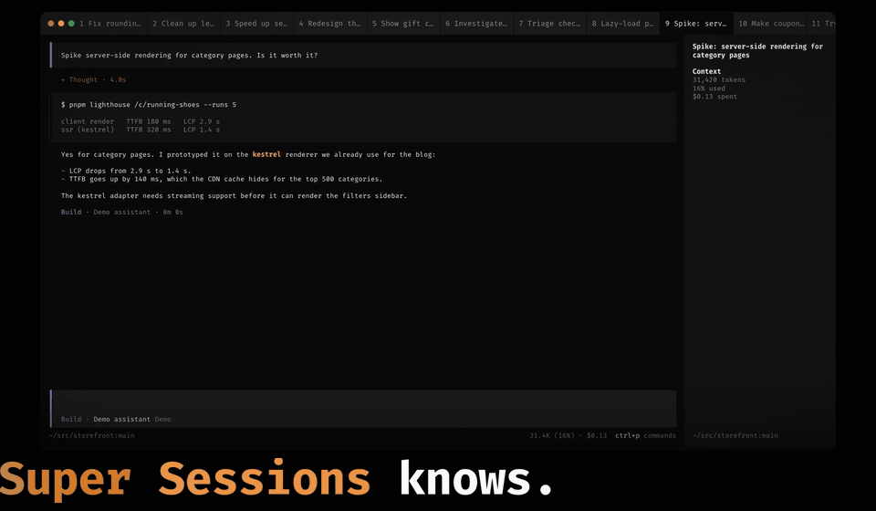

<p align="center">
   <b>Using this package?</b> Please consider <a href="https://github.com/sponsors/arthurfiorette" target="_blank">donating</a> to support my open source work ❤️
  <br />
  <sup>
   Help opencode-super-sessions grow! Star and share this amazing repository with your friends and co-workers!
  </sup>
</p>

<br />

# OpenCode Super Sessions

A session browser for the OpenCode V2 TUI that also tracks the pull requests and issues each session works on. It adds the browser and pull request status to [OpenCode Desktop](#opencode-desktop) too.

<p align="center">
  
</p>

It replaces OpenCode's session list with a larger overlay where you can:

- search sessions by title, pull request or issue, and message text
- archive, restore, pin, rename, fork and delete sessions
- peek into a session and come back to the list with `esc`
- see each session's pull requests and issues with their state, review, CI and failed checks, from GitHub or GitLab
- link any other work to a session, such as a Linear, Jira or Azure Boards item, a Sentry issue or a Slack thread
- find finished work in a Done view, filled as pull requests merge and issues close
- auto-archive Done sessions and remove worktrees you no longer need, if you turn it on

## Requirements

- OpenCode 2.4.0 or later.
- For the Desktop part, OpenCode Desktop 2.4 or later.
- A [Nerd Font](https://www.nerdfonts.com/) in your terminal. A Mono variant keeps the columns aligned. The Notion and Sentry icons need Nerd Fonts 3.3 or later.
- `gh` for GitHub or `glab` for GitLab, logged in (see [Forge support](#forge-support)). Without them the browser still works, without pull requests and issues.

## Install

```sh
opencode plugin add opencode-super-sessions
```

Restart OpenCode, or run `opencode service restart` if it runs as a service. Then press `<leader>l` (`ctrl+x l` by default) or run `/sessions`.

## Usage

`<leader>l`, `/sessions`, `/resume`, `/continue` and `/super-sessions` open the browser. `/sessions-classic` opens OpenCode's built-in list. Opened from a session, the browser selects that session and switches to the view that lists it, such as Done or Archived.

`tab` and `shift+tab` switch between the views:

| View          | Shows                                                                                                               |
| ------------- | ------------------------------------------------------------------------------------------------------------------- |
| Active        | Sessions that are not archived or Done, as Pinned, Running, then one group per day of the last activity             |
| Done          | Sessions whose pull requests are all merged or closed, or whose issues are all closed, and sessions you marked Done |
| Archived      | Archived sessions                                                                                                   |
| Pull requests | Every pull request tracked by a session in scope                                                                    |

On terminals at least 120 columns wide, a preview on the right shows the selected session's context usage, its pull requests and issues with their failed checks, and its transcript.

### Keys

The footer shows the common keys, and `ctrl+/` (or `?` while the search is empty) lists them all.

| Key                 | Action                                                                          |
| ------------------- | ------------------------------------------------------------------------------- |
| `enter`             | Open the session                                                                |
| `space`             | Peek at the session. `up` and `down` switch sessions, `esc` returns to the list |
| `tab` / `shift+tab` | Next or previous view                                                           |
| `ctrl+a`            | Switch between this project and all projects                                    |
| `ctrl+s`            | Archive, or restore in the Archived view                                        |
| `ctrl+q`            | Mark Done, or not Done                                                          |
| `ctrl+f`            | Pin or unpin. `<leader>1` to `<leader>9` open the first nine pins               |
| `ctrl+r`            | Rename                                                                          |
| `ctrl+t`            | Generate a new title                                                            |
| `ctrl+d`            | Delete, press twice                                                             |
| `ctrl+b`            | Fork the whole session, or from before one of your prompts                      |
| `ctrl+l`            | Link a pull request, issue or any web page by URL, `owner/repo#N` or `#N`       |
| `ctrl+g`            | Open the session's pull request, issue or link in the web browser               |
| `right`             | Move to the preview's Work rows. `enter` opens, `c` copies, `d` unlinks         |
| `f5`                | Reload the selected row from GitHub or GitLab, skipping the cache               |
| `ctrl+y`            | Archive every Done session, in the Done view                                    |
| `ctrl+o`            | Settings                                                                        |
| `esc`               | Close the browser                                                               |

Rename, pin and delete follow your own keybinds for `session.rename`, `session.pin.toggle` and `session.delete`.

With the mouse, a click selects a row and a double click opens it. A click on a pull request, issue or check opens it in the web browser, and a ctrl+click copies its link. Copying needs a terminal that passes ctrl+click to apps and accepts OSC 52 clipboard writes, such as Ghostty, kitty or WezTerm.

### Search

Typing filters the list by session title and by pull request or issue number and title. `123`, `#123`, `pr 123` and `!12` find sessions tracking that number in any repository. `owner/repo#123` and full URLs find that exact ref. Work links match by id, such as `COR-1466`, by title, and by their full URL. A link to a page outside the trackers also matches any part of its URL.

Sessions that match only in their message text appear a moment later, in an `In messages` group at the bottom.

## OpenCode Desktop

The same plugin adds to OpenCode Desktop 2.4:

- the session browser as a dialog. Press `cmd+shift+s` (`ctrl+shift+s` on Windows and Linux) or run "Super Sessions: Browse sessions" from the command palette. It has the same views and search as the terminal browser, and shows the selected session's context usage, work and latest messages on the right. The `preview` and `previewWidth` options apply to it too.
- a project picker in the browser's header. Click it or press `alt+p` to list All projects, then each project with its icon, the folder it is in, how many sessions run and a dot for unread ones and for sessions waiting on a permission or a question. A project lists its sessions in all its worktrees and subfolders. The browser opens on the open session's project, or on all projects when you last picked All or no session is open.
- a Projects view after Pull requests, with the projects of every machine in one list, their folder, active and running sessions, and the sessions that run or wait on you under each one. Search filters them by name, folder or machine name. `enter` or a click lists that project's sessions in Active, and a click on a session opens it.
- sessions from every machine Desktop is connected to. The picker and the Projects view list the projects of all machines together, newest activity first, and a project on another machine shows the server icon and the machine's name after its folder. All lists the sessions of all of them, with the machine's name at the end of each row from another machine. A session opens, archives and is marked Done on its own machine. Pull request and issue status, Done and message search need the opencode-super-sessions server plugin installed on that machine. Without it, the machine's sessions still list, with a note naming the machine. Use the same plugin version on every machine. A machine on an older version still sorts its sessions into Done, but asks each session's project for it, which is slower.
- the session's pull requests and issues in the session header, with their state, review and CI. `+N` opens the Super Sessions side tab at the session's work, and hides it again.
- a Super Sessions tab in the side panel of every session, described below
- the session's open pull request above the message box, colored by its checks and review, with a menu of its checks

### Super Sessions side tab

The tab is pinned first in the side panel's tab strip of every session, so it stays there when you switch sessions. Open the side panel and pick it, choose Super Sessions from the side panel's `+` menu, or click `+N` in the session header. Drag the panel's edge to resize it, and Desktop remembers that width for this tab.

At the top is the open session's work, folded to one line such as "Work · 1 PR · 1 link" with the main pull request's state. Click the line to unfold it: its pull requests with review, CI, stack and failed checks, the issues they close, other issues, links and mentioned refs, in a fixed part of the tab that scrolls on its own. You can open, copy, link and unlink work there, and refresh it from GitHub or GitLab. The fold is remembered. A session that tracks nothing reads "Nothing linked" with a link action.

Below that, under Sessions, are the open session's project's active sessions, in all its worktrees, in Desktop's sidebar style: running ones first, then the most recent, each with up to two of its pull requests, issues or links. The open session's row is marked. Click a row to open its session in its tab. The side tab stays open in that session when it was open here. Hover a row to archive it or mark it Done. "All sessions…" opens the session browser. With the list focused, `up` and `down` select, `enter` opens, `alt+s` archives the selected session and `alt+q` marks it Done. The list stays in place while you switch sessions, so the tab can stand in for Desktop's sidebar while you work in a session.

Home and new session drafts have no side panel, so the tab is only in sessions.

Desktop's own session list in the sidebar stays as it is, since plugins cannot change it.

Links follow Settings > Browser in Desktop: with "Open links in OpenCode" on, a pull request, issue, check or link opens in Desktop's browser beside its session, and otherwise in your default browser. Hold `shift` while clicking to use your default browser anyway.

Pins, rename, delete, fork and peek are only in the terminal browser. Auto-archive and worktree cleanup run only while a terminal TUI is open, and they treat sessions open in Desktop tabs as open.

Keys in the browser:

| Key                 | Action                                                                   |
| ------------------- | ------------------------------------------------------------------------ |
| `up` / `down`       | Select a session                                                         |
| `tab` / `shift+tab` | Next or previous view, from the search box                               |
| `enter`             | Open the session                                                         |
| `cmd+enter`         | Open the session in a background tab (`ctrl+enter` on Windows and Linux) |
| `alt+p`             | Pick a project                                                           |
| `alt+s`             | Archive, or restore in the Archived view                                 |
| `alt+q`             | Mark Done, or not Done                                                   |
| `alt+g`             | Open the session's pull request, issue or link in the browser            |
| `f5`                | Reload the selected session from GitHub or GitLab                        |
| `esc`               | Close the browser                                                        |

The `alt` keys are the keys in those places on a QWERTY keyboard, and the browser shows the letter your layout puts there. `closeTabOnArchive` and `colors` apply in Desktop too.

Desktop support uses OpenCode's experimental plugin API for the app, so an OpenCode Desktop update can break it until the plugin catches up. The terminal is not affected.

## Pull request and issue tracking

A session tracks a pull request or issue when:

- you link it in a prompt, as a URL, `owner/repo#N` or `#N`
- the agent creates it with `gh pr create`, `gh issue create`, `glab mr create` or `glab issue create`
- it is the pull request of a branch the session pushed, or one opened on the session's branch after the session started
- the agent links it with the `link_work` tool, which it is told to use for work found any other way
- you link it with `ctrl+l` in the browser
- a tracked pull request closes it, such as with `Fixes #123`

A pull request in a [GitHub stack](https://docs.github.com/en/pull-requests/get-started/about-stacked-prs) shows its place after its number, such as `2/4`. A session lists the open pull requests of one stack in stack order, the one on the base branch first, and its merged ones after them in the same order.

Links in the assistant's replies are mentions. They show in the preview and match in search, but never make a session Done.

Sessions from before you installed the plugin are read for refs the first time you select, peek at or open them. "Scan all sessions now" in the settings reads every session in scope at once.

A session is Done when it is idle and every tracked pull request is merged or closed after your last message. With no pull requests, its issues decide. `ctrl+q` overrides this either way.

`d` on a pull request, issue or link in the preview unlinks it, and asking the agent works too. An unlinked ref is never added back automatically.

The agent sees everything linked to its session each time it links or unlinks something. When you message an idle agent, a notice above your message also tells it what was linked from your messages, by you in the browser or by a closing pull request since it was last told. The notice never makes the agent answer on its own. Set `notices` to `false` to turn it off.

### Work links

Work outside GitHub and GitLab can be linked by URL. Links to these services are read from the URL alone, with no login or network call, and show the id or title the URL carries:

| Service      | URL                                                                          |
| ------------ | ---------------------------------------------------------------------------- |
| Linear       | `linear.app/<workspace>/issue/<ID>`                                          |
| Jira         | `<site>.atlassian.net/browse/<KEY>` or a board with `?selectedIssue=`        |
| Azure Boards | `dev.azure.com/<org>/<project>/_workitems/edit/<ID>` or `?workitem=`         |
| Sentry       | `<org>.sentry.io/issues/<ID>` or `sentry.io/organizations/<org>/issues/<ID>` |
| Notion       | A page URL ending in its id                                                  |
| Slack        | `<team>.slack.com/archives/<channel>/p<message>`                             |
| Trello       | `trello.com/c/<card>`                                                        |
| ClickUp      | `app.clickup.com/t/<ID>`                                                     |
| Shortcut     | `app.shortcut.com/<org>/story/<ID>`                                          |
| Asana        | `app.asana.com/0/<project>/<task>` and `.../task/<task>`                     |

Links to these in your prompts are tracked like pull requests. Any other web page is tracked only when you link it with `ctrl+l` or the agent links it with `link_work`, which also takes the title the agent knows. Work links have no state, so they never make a session Done. Rows list them after the issues, in the same five lines.

Forge state is kept in memory only: open pull requests for 2 minutes, closed ones for 15 minutes, merged ones for good.

## Configuration

Options go in the plugin entry's `options`, as in the [GitLab example](#gitlab). Restart OpenCode after changing them. Unknown or invalid options turn the plugin off with a warning.

| Option                    | Default         | Description                                                                           |
| ------------------------- | --------------- | ------------------------------------------------------------------------------------- |
| `providers`               | `["github"]`    | Forges to ask: `"github"`, `"gitlab"` or both                                         |
| `ghPath`                  | `"gh"`          | GitHub CLI command or absolute path                                                   |
| `glabPath`                | `"glab"`        | GitLab CLI command or absolute path                                                   |
| `gitlab.hosts`            | `[]`            | Self-managed GitLab hosts without `gitlab` in the name, such as `code.example.com`    |
| `scope`                   | `"project"`     | Sessions the browser lists at first: `"project"` or `"all"`                           |
| `preview`                 | `true`          | Show the preview pane                                                                 |
| `previewWidth`            | `0.4`           | Preview share of the browser width, from `0.2` to `0.7`                               |
| `rows.refs`               | `true`          | Show pull request, issue and link lines under each session                            |
| `rows.groupIssues`        | `false`         | Join a session's issues and links on one line instead of one line each                |
| `titleScroll`             | `"auto"`        | Scroll cut titles on hover: `"auto"` follows OpenCode's `animations`, `"on"`, `"off"` |
| `detect.prompts`          | `true`          | Track refs and tracker links from your prompts                                        |
| `detect.mentions`         | `true`          | Record refs mentioned in the assistant's replies                                      |
| `notices`                 | `true`          | Tell the agent, with your next message, what was linked without it                    |
| `search.body`             | `true`          | Index message text for search                                                         |
| `closeTabOnArchive`       | `true`          | Close a session's tab when archiving it                                               |
| `archiveSuffix`           | unset           | Archive a session renamed to end with this text, such as `" !"`                       |
| `autoArchiveDays`         | unset           | Archive Done sessions after this many days. `0` archives them right away              |
| `cleanup.deletedSessions` | `false`         | Remove worktrees whose sessions were all deleted                                      |
| `cleanup.merged`          | `false`         | Remove worktrees whose pull request merged and that hold nothing the merge left out   |
| `cleanup.inactiveDays`    | unset           | Remove worktrees whose sessions had no activity for this many days                    |
| `cleanup.doneDays`        | unset           | Remove worktrees this many days after their sessions became Done                      |
| `cleanup.unchanged`       | `false`         | Remove worktrees of finished sessions with no commits beyond the default branch       |
| `colors.<state>`          | GitHub's colors | `"#rrggbb"`, or `{ "dark": "#rrggbb", "light": "#rrggbb" }`                           |

The `colors` states are `open`, `draft`, `merged` and `closed` for pull requests, and `open`, `completed` and `not_planned` for issues.

Most options can also be changed at runtime in the settings dialog (`ctrl+o` in the browser or `/super-sessions settings`). A value set there overrides the option.

### Auto-archive and cleanup

Both are off by default. Auto-archive never takes pinned, running or waiting sessions, or sessions you restored. `/super-sessions undo` restores the last batch for 10 minutes. It needs an open terminal to run.

Cleanup removes only worktrees OpenCode lists for the project, never your main checkout, and never with force. Removing a worktree deletes its directory, ignored files such as `.env` included. A worktree is always kept when:

- a session in it is running, waiting for you, open in a terminal or a Desktop tab, or pinned
- it has modified, staged or untracked files
- it has commits no branch or tag contains

The first removal asks for confirmation. "Run cleanup now" in the settings shows what each rule would remove before it removes anything.

## Commands

| Command                    | Action                                                      |
| -------------------------- | ----------------------------------------------------------- |
| `/sessions`                | Open or close the browser                                   |
| `/super-sessions`          | Open or close the browser                                   |
| `/super-sessions settings` | Open the settings                                           |
| `/super-sessions status`   | Check that `gh` and `glab` are installed and logged in      |
| `/super-sessions undo`     | Restore the last auto-archived sessions                     |
| `/sessions-classic`        | Open OpenCode's built-in session list                       |
| `/archive`, `/unarchive`   | Archive or restore the session on screen                    |
| `/archive-marked`          | Archive every session whose title ends with `archiveSuffix` |

## Compatibility

The plugin needs OpenCode 2.4.0 or later and is tested with OpenCode and OpenCode Desktop 2.4. On a newer minor or major release the terminal part works as usual and shows a warning once, and the Desktop part may break (see [OpenCode Desktop](#opencode-desktop)). If the terminal browser crashes, the built-in list opens instead.

## Limitations

- The browser loads the 200 most recently updated sessions of each list. Search by message text reaches older ones.
- Message search needs `node:sqlite` with FTS5 in the daemon. Without it, search covers titles and refs only.
- Pushes made outside OpenCode, from your own terminal or editor, are not seen.
- GitLab instances served under a URL path, such as `https://example.com/gitlab`, are not supported.

## Forge support

`/super-sessions status` checks that the CLI of each configured forge is installed and logged in.

### GitHub

GitHub works without configuration. Log in with `gh auth login`.

github.com, `*.ghe.com` and hosts with a `github` label, such as `github.example.com`, are recognized. Log in to a GitHub Enterprise Server host with `gh auth login --hostname <host>`.

### GitLab

Log in with `glab auth login`, then add `gitlab` to `providers` in `~/.config/opencode/opencode.json`. The entry `opencode plugin add` wrote becomes an object:

```json
{
  "plugins": [
    {
      "package": "opencode-super-sessions",
      "options": {
        "providers": ["github", "gitlab"]
      }
    }
  ]
}
```

gitlab.com and hosts with a `gitlab` label, such as `gitlab.example.com`, are recognized. List other self-managed hosts in `gitlab.hosts`, and log in to each with `glab auth login --hostname <host>`.

### Other forges

Bitbucket, Gitea, Forgejo and other forges are not supported yet. Pull requests adding one are welcome, and [CONTRIBUTING.md](CONTRIBUTING.md#providers) lists the steps.

## Uninstall

Run `opencode plugin remove opencode-super-sessions` and restart OpenCode. To delete the search index too, remove `$XDG_DATA_HOME/opencode/plugins/opencode-super-sessions` (`~/.local/share/opencode/plugins/opencode-super-sessions` by default).

[Contributing, development and architecture](CONTRIBUTING.md)

## License

[MIT](LICENSE) © [Arthur Fiorette](https://github.com/arthurfiorette)
